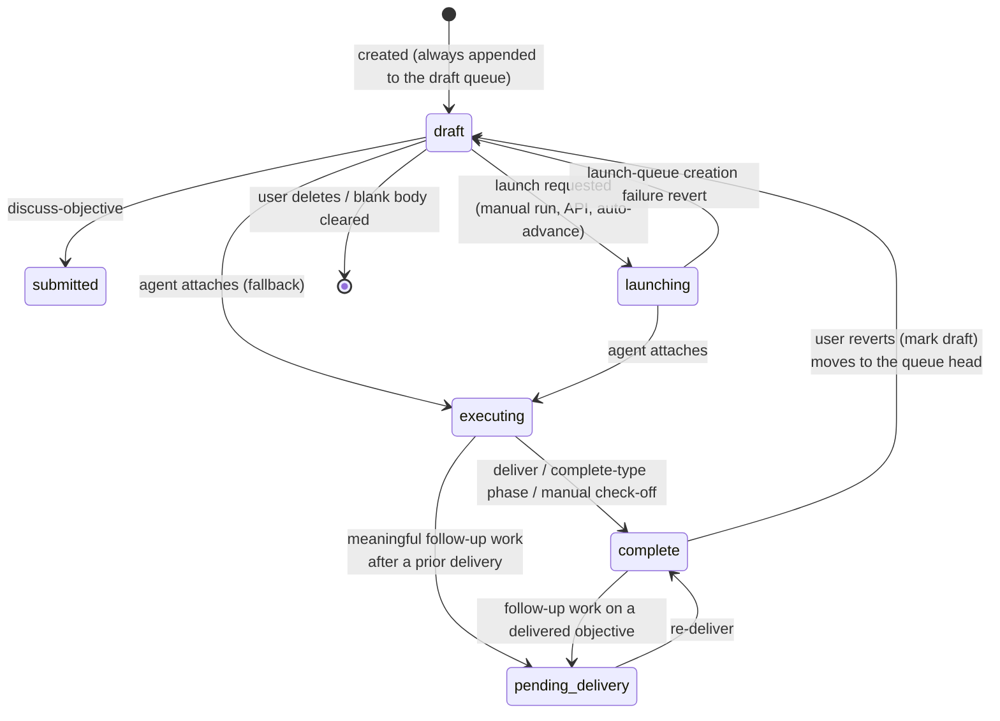

# Objective Manager: Objective Lifecycle Within a Mission

This document specifies how objectives behave within a mission: which states exist,
what triggers every state transition, and the invariants the system enforces at all
times. It is written as a portable, implementation-agnostic specification so the
behavior can be replicated on any storage layer or runtime.

It complements, and must stay consistent with:

- [`cli/docs/06-core-domain-and-lifecycle.md`](../../../cli/docs/06-core-domain-and-lifecycle.md) — domain concepts and required states.
- [`cli/docs/03-agent-protocol.md`](../../../cli/docs/03-agent-protocol.md) — the protocol verbs that drive transitions.
- [`cli/docs/04-runner-and-launch-execution.md`](../../../cli/docs/04-runner-and-launch-execution.md) — the execution-request queue and runner.
- [`contract/data/README.md`](../../../contract/data/README.md) — the `objectives` and `execution_requests` tables.

Per `contract/architecture.md`, the database layer owns the schema and constraints, the protocol
layer owns the transition-triggering verbs, and the CLI/runner owns launch execution.
This document is the cross-cutting behavioral specification those layers implement
together; it does not change any stable interface.

## Concepts

A **mission** represents a whole feature or goal. Each mission owns an ordered queue of
**objectives** — one objective equals one agent prompt/work session. Objectives advance
through a state machine driven by three kinds of triggers:

1. **User actions** — run, reorder, edit, complete, revert.
2. **Agent protocol calls** — `attach`, `update`, `deliver`.
3. **Background automation** — auto-advance after delivery, launch settlement.

There is no queue refill. A mission's unstarted objectives form one ordered **draft
queue** (`draft` and `submitted`, by position); "next up" is always *derived* from that
queue, never maintained by promoting or demoting rows. **Auto-advance is opt-in
policy**: a draft launching automatically after a delivery happens only when the user
enabled `auto_advance` on that objective.

---

## 1. State catalog

`objectives.state` has six values (`draft`, `submitted`, `launching`, `executing`,
`pending_delivery`, `complete`). Earlier versions also had `future`; it was retired
(contract ADR 0056) and every former `future` row is now a `draft`.

| State              | Meaning                                                                                                                                                                                                               | Instruction text may be empty? |
| ------------------ | --------------------------------------------------------------------------------------------------------------------------------------------------------------------------------------------------------------------- | ------------------------------ |
| `draft`            | An unstarted objective in the mission's ordered draft queue. A mission may hold any number of drafts.                                                                                                                  | Yes                            |
| `submitted`        | A draft surfaced to an agent for discussion (`discuss-objective`). Stays in the draft queue: reorderable and explicitly launchable.                                                                                     | No                             |
| `launching`        | A launch has been requested (an execution request exists) but no agent has attached yet. Covers the whole pre-attach window. Still a kind of draft: editable and re-queueable, and still the mission's "next up" slot. | No                             |
| `executing`        | An agent session is attached and actively working the objective.                                                                                                                                                      | No                             |
| `pending_delivery` | Follow-up execution after a prior delivery produced new work that needs a re-delivery.                                                                                                                                | No                             |
| `complete`         | Done. `completed_at` is set.                                                                                                                                                                                          | No                             |

Conceptually there are three groups:

- **Queue states** — `draft` and `submitted`: the reorderable draft queue.
  `launching` straddles the boundary — it has been handed to the launch pipeline and
  keeps its position (it is not reorderable), but it remains editable and
  re-queueable until an agent actually attaches.
- **Active states** — `executing`, `pending_delivery`: an agent has the objective.
- **Terminal state** — `complete`. Re-enterable: a user may revert a completed
  objective to `draft`, and follow-up work may pull it back into the active set as
  `pending_delivery`.

Two derived state sets are used throughout the rules below:

- **Launchable** (an execution request may be created or claimed for the objective):
  `draft`, `submitted`, `launching`.
- **Queued** (reorderable): `draft`, `submitted` (`QUEUED_OBJECTIVE_STATES`).

Three derived selectors, none persisted, all ordered by `position`, then
`created_at`, then `id`:

- **Queue head** (`queueHeadObjective`) — the first `draft` or `submitted`
  objective, blank allowed. The mission panel renders it as the full card.
- **First draft** (`firstDraft`) — the first `draft`, blank allowed. Used for
  editing, `discuss-objective` defaults and the mission card's draft resource badge.
- **Next runnable draft** (`nextUpDraft`) — the first `draft` with non-empty
  instruction text. The only selector automatic paths use (auto-advance,
  awaiting-approval notices, default attach after active-state resolution). It skips
  `submitted` objectives and blank drafts.

> Naming note: `objectives.state = 'launching'` and
> `execution_requests.status = 'launching'` are **different fields with different
> lifespans**. The objective state covers the entire request-created → attach window;
> the request status only covers the post-spawn/pre-attach window. See
> [Section 7](#7-companion-state-machine-execution-requests).

---

## 2. State diagram



Discussion (`draft → submitted`) does not launch anything. Only an explicit execution
order (launch request or attach) moves an objective out of the draft queue.

---

## 3. Required invariants

These rules must hold at all times, regardless of which code path writes. Enforce them
**transactionally in the storage layer where the database can express them** (unique
partial indexes, check constraints, triggers); where it cannot, the service layer must
enforce them and the adapter conformance suite must test that enforcement.

1. **Any number of drafts.** There is no single-draft invariant; drafts are ordered
   by position.
2. **At most one `executing` _or_ `pending_delivery` objective per mission, unless
   `missions.allow_parallel_objectives` is true.** The default remains serial so
   auto-advance races cannot leave two objectives active on the same checkout.
   When the flag is on, several active objectives are allowed on any resource,
   including the same one. Checkout safety moves to the Runner Layer: a mission that
   uses worktrees puts a concurrently launched same-resource objective on its own
   branch (`<mission branch>-<objectives.display_key>`) in its own worktree, and a
   mission that runs without worktrees has one checkout that both objectives share
   deliberately — file attribution then comes only from each explicitly bound
   objective/session ledger, never from a checkout-wide scan.
3. **Unique per-mission positions.** `position` is an integer, unique per mission,
   0-based.
4. **Auto-assigned position on insert.** When a caller omits `position`, the system
   assigns `max(position) + 1` for the mission. Callers doing manual reorders set
   positions explicitly.
5. **Non-empty instruction text in `launching` and beyond.** An objective can never
   enter `launching`, `executing`, `pending_delivery`, or `complete` with blank
   instruction text. (Blank text is allowed only in `draft`.)
6. **`completed_at` is system-managed.** Entering `complete` stamps
   `completed_at = now()` (if not provided); moving to any non-`complete` state
   clears it.
7. **At most one active agent session per objective.** A new attach must first detach
   any prior active session for the objective.
8. **At most one in-flight execution request per objective.** All launch paths reuse
   or re-queue an existing active request instead of inserting duplicates.
9. **`auto_advance` defaults to `false`.** Auto-advance is explicit opt-in per
   objective.
10. **CAS-guarded transitions.** Every state change is guarded on the expected current
    state (compare-and-swap on `state`), so concurrent triggers degrade to no-ops,
    never to duplicate transitions.

---

## 4. Ordering rules and the position queue

- **Canonical sort order is `position ASC`, tie-broken by `created_at ASC`.** Every
  "pick the next objective" query in the system uses this order
  (`sortObjectivesByLifecycleOrder`).
- **Display order is not the position queue.** Once objectives can run out of
  order — parallel objectives, run queues, ad-hoc launches — position no longer
  describes what happened, so a mission's objective list
  (`sortObjectivesForMissionDisplay`) reads as history followed by plan:
  1. `complete`, oldest `completed_at` first;
  2. `executing` / `pending_delivery`, oldest `started_at` first;
  3. `launching`, oldest `launched_at` first;
  4. `draft` / `submitted` (the draft queue), in position order.

  Each group sorts by its own recorded moment; a missing moment (rows written
  before the timestamps existed) falls back to position, so an untimestamped
  mission renders exactly as it did before. Only group 4 is position-ordered,
  which is why drag-to-reorder covers the draft queue alone. Planning and dispatch
  (`decideAutoAdvanceAfterDelivery`, run-queue dispatch) keep using the position
  order — display order is presentation only.
- **Lifecycle timestamps.** `objectives.launched_at` and `objectives.started_at`
  are stamped first-wins (`COALESCE`) on entry to `launching` and `executing`;
  `completed_at` is written on delivery. First-wins matters: re-launching, or
  re-attaching for follow-up work after a delivery, must not move an objective
  that already earned its place in the list.
- **Appending** (protocol `create`, `add-objectives`, UI "add objective"): new rows
  take `max(position) + 1` per insert order and are always `draft`. No other row
  changes.
- **User reorder** (drag-and-drop or equivalent, `reorderObjectives`):
  - The request must name **exactly** the mission's live `draft` + `submitted` set,
    in the new order. Missing, extra, duplicate, foreign or non-queued IDs are
    rejected; a stale set is a conflict and the client refetches.
  - The reordered queue **recycles the sorted position slots the set already
    holds**, so reordering never moves a launching/executing/complete objective,
    even one positioned between queued objectives.
  - Persistence must satisfy the unique-position invariant mid-write — for example a
    two-phase write (move affected rows to temporary high positions, then write final
    positions) or a single transaction with deferred constraint checking.
  - Run Queue order for the mission's waiting/blocked entries follows in the same
    transaction.
- **Reopen**: reverting an objective to `draft` moves it to the queue head by
  redistributing the reopened row and the queued rows over their existing slots;
  every other row keeps its position.
- **Deletion**: draft objectives may be deleted. Clearing the instruction text of a
  draft through the editor also deletes it (unless it has attachments or history).
  Positions are _not_ compacted on delete; uniqueness and relative order are
  sufficient.
- **Editing**: instruction text is only editable in `draft`, `submitted`, and
  `launching` (a launching objective is still a draft in spirit — editable and
  re-queueable until an agent attaches). Text in `executing`, `pending_delivery`,
  and `complete` is immutable through editing surfaces.

---

## 5. Transition reference

Every transition, its trigger, guard conditions, and side effects.

### 5.1 Creation

| Trigger                                                | Resulting state                                                                    | Notes                                                                                                                                             |
| ------------------------------------------------------ | ---------------------------------------------------------------------------------- | ------------------------------------------------------------------------------------------------------------------------------------------------- |
| Mission created with objectives (protocol `create`, UI) | Every objective `draft`                                                            | A create-and-run variant (e.g. `prompt`) additionally requests execution immediately.                                                             |
| `add-objectives` protocol call                         | Every appended objective `draft`                                                    | Appended at the end of the queue; no other row changes.                                                                                            |
| UI "add objective"                                     | `draft`                                                                            | The empty composer is client-only until text is saved. New row inherits `assigned_agent` from the most recently set agent on the mission.         |

### 5.2 Discussion — `draft → submitted`

`discuss-objective` marks a draft `submitted` (the explicit objective, or the first
draft when none is named). No session is created and the objective keeps its queue
position. **Discussion ≠ execution**: only an explicit execution order (a launch
request, 5.3, or an attach, 5.4) moves an objective out of the draft queue. Automatic
selection skips submitted objectives; they remain explicitly launchable.

### 5.3 `draft` → `launching` — launch requested

**Trigger:** an execution request is created for the objective. Sources
(`requested_source`): a user manually running the objective, the public API/CLI, or
auto-advance after a delivery (see 5.6).

Sequence (all steps guarded so races cannot double-queue):

1. Resolve the target objective: the explicit objective ID (any draft, submitted or
   launching objective — there is no promote step), or the **lowest-position
   launchable** objective on the mission.
   Reject if instruction text is empty, the state is not launchable, or the mission is
   marked human-only.
2. **Dedup:** if an active (`queued`/`claimed`/`launching`) execution request already
   exists for the objective, reuse it — a stale `claimed`/`launching` request is
   CAS-reset to `queued` and a fresh `execution_requested` event is emitted so runners
   wake up. No new request, no objective-state change beyond what already happened.
3. If the objective is `draft`, update it to `launching` (CAS-guarded on
   `state = 'draft'`). Auto-advance also stamps `auto_advanced_at`. (A `launching`
   objective stays `launching`.)
4. Insert the execution request with `status = 'queued'` and an idempotency key
   (`auto_advance:<objective_id>` for auto-advance; unique otherwise). A uniqueness
   violation on insert is resolved by reusing the request that won the race.
5. Emit an `execution_requested` mission event (this is what wakes runners).

**Failure revert:** if the request cannot be created (insert error, unresolvable
race), revert the objective `launching` → `draft` (CAS-guarded on
`state = 'launching'`) and clear `auto_advanced_at`. This is the only automated
backward transition out of `launching`.

### 5.4 `launching`/`draft` → `executing` — agent attaches

**Trigger:** an agent calls `attach` (or an attach-equivalent verb such as
`connect`/`spawn` that shares the same transition logic).

1. **Selection order:** an explicit objective id pins the objective. Otherwise the
   single `executing`, `launching` or `pending_delivery` objective (two equally ranked
   active objectives are ambiguous), then the first `submitted` objective (the
   discuss → attach flow), then the next runnable draft, then the first draft —
   each in canonical order.
2. **Re-attach idempotency:** when no launchable objective exists but the mission
   already has an `executing` or `pending_delivery` objective, attach returns that
   objective **without changing state**. This lets an agent that lost its session key
   recover by re-attaching.
3. Guard: an assigned agent must resolve from the objective (or attach metadata);
   attach fails otherwise.
4. Update the objective: `state = 'executing'`, stamp the agent and model
   identifiers, clear `completed_at`.
5. No queue refill: other drafts are untouched.
6. **Session bookkeeping:** detach any prior active session for the objective
   (invariant #7), then create the new agent session.
7. **Execution request settlement:** mark the matching request `launched` (prefer a
   request ID threaded through attach metadata; fall back to the objective's active
   request). **Attach is the source of truth for a successful launch.** Settlement
   failures never fail attach; manual launches with no request are a no-op.
8. **Mission status:** move the mission to the project's `execute`-type status. If the
   previous status was `review`/`complete`-type, also emit a reopened event.
9. Fire-and-forget secondary automation: generate an objective title (see the
   `summarize-objective-title` automation in
   [`01-automations-overview.md`](../../../automations/docs/01-automations-overview.md)).

### 5.5 `executing` (and others) → `complete` — delivery

**Trigger:** the agent calls `deliver`. After persisting the delivery event,
artifacts, delivery report, and any declared paths:

1. Update the session's objective to `complete` with `completed_at = now()`,
   CAS-guarded on `state IN ('executing','pending_delivery','launching','draft')` —
   deliver completes the objective from any active state, but never resurrects an
   already-complete row.
2. Mark the agent session completed/detached **before** auto-advance runs, so
   launchers see no active session when the next `execution_requested` event arrives.
3. Run the **auto-advance decision** (5.6).
4. If auto-advance did **not** queue anything: move the mission to the project's
   `review`-type status, placed at the **top** of that board column, and emit a
   `status_change` event.

Other paths to `complete`:

- **Agent marks the mission complete:** a protocol `update` with a phase that maps to a
  `complete`-type status marks all `executing`/`pending_delivery` objectives on the
  mission `complete`.
- **Manual check-off (user):** sets any non-complete objective to `complete`. Any
  active execution requests for the objective are cancelled. Idempotent for
  already-complete objectives.

### 5.6 Auto-advance decision (runs inside deliver)

After completing the delivered objective, inspect the **next runnable draft**
(`nextUpDraft`) on the mission — regardless of whether it sits before or after the
delivered objective, since objectives can launch out of order:

```text
next_draft = lowest-position draft with non-empty instruction text (skips submitted)
if none                     → no advance → mission goes to review
elif mission is human-only   → no advance
elif draft.auto_advance     → (requires assigned agent)
                              draft → launching, insert queued execution request,
                              emit execution_requested  → runner launches next agent
else (auto_advance = false) → emit blocking awaiting_approval event
                              (summary = objective.approval_reason or a default),
                              flag the mission as awaiting a response,
                              notify the user; objective STAYS draft
```

Notes:

- Auto-advance is **policy, not structure**: it only chooses whether the next draft
  _launches_ automatically.
- A saved **blank** draft never auto-advances and is skipped by automatic selection.
- In production, delivery enqueues the durable Run Queue worker; explicit Run Queue
  membership and order stay authoritative. A later queued objective does not
  implicitly enqueue earlier unqueued drafts.
- The awaiting-approval branch counts as "advanced" for mission-status purposes: the
  mission does **not** move to review while an approval is pending.
- **Approval gating:** an agent can pre-gate a queued objective (set
  `auto_advance = false` plus an `approval_reason`). A user approves by setting
  `auto_advance = true`, which clears `approval_reason` and the mission's waiting flag;
  the objective then launches on the next trigger (manual run, or auto-advance after
  the next delivery). Toggling `auto_advance` is only allowed while the objective is
  in `draft`/`submitted`/`launching`; enabling it clears `approval_reason`.

### 5.7 → `pending_delivery` — follow-up work after a delivery

**Trigger:** after an objective has at least one delivery, a subsequent protocol
`update` call carrying a **meaningful follow-up work signal**
transitions it to `pending_delivery`. Meaningful signals:

- a commit ID or diff stat in the snapshot,
- explicit follow-up intent of `pending_delivery`,
- non-empty artifacts/deliverables in the payload,
- an `update` event with execution intent (follow-up intent of `execution`, or an
  `execute` phase).

A bare "begin follow-up work" announcement is **not** itself a work signal — it merely
declares intent. The transition is CAS-guarded on
`state IN ('executing','launching','draft','complete')` — note this is the one
transition that can pull a `complete` objective back into the active set. Because of
invariant #2, a mission can hold only one `executing`-or-`pending_delivery` objective,
so pending redelivery blocks a second active objective.

`pending_delivery` resolves only via a new `deliver` (→ `complete`, per 5.5). A
delivery-status check reports redelivery as needed while an objective sits in this
state, prompting agents to re-deliver.

### 5.8 Manual user overrides

| Action          | Transition                                                                   | Preserved invariants                                                                                    |
| --------------- | ---------------------------------------------------------------------------- | ------------------------------------------------------------------------------------------------------- |
| Mark draft      | any state → `draft`; `completed_at` cleared; reopened rows move to the queue head | No other draft changes state; only queued rows' slots are redistributed.                   |
| Reorder         | no state change; positions recycled within the draft+submitted set           | Exact-set validation; position uniqueness via constraint-safe write; Run Queue order synced. |
| Delete draft    | `draft` row soft-deleted                                                     | Executed history is never removed this way.                                                 |
| Manual complete | see 5.5                                                                      | Execution-request cancellation.                                                             |

---

## 6. The draft queue (no refill)

Earlier designs kept exactly one `draft` and refilled it (`ensureDraftSlot`) by
promoting the next `future` objective whenever the draft left the queue. That
machinery is gone. The steady-state shape of a mission is:

```text
[complete*] [executing|pending_delivery*] [launching*] [draft|submitted* — ordered queue]
            └ default: at most one; opt-in parallel ┘
```

The empty "type here" composer is a client-only affordance at the end of the queue;
it is never persisted as a blank row.

---

## 7. Companion state machine: execution requests

Launch automation is mediated by a durable queue (see
[`cli/docs/04-runner-and-launch-execution.md`](../../../cli/docs/04-runner-and-launch-execution.md)
and the `execution_requests` table in the schema contract). The happy path is
`queued` → `claimed` → `launching` → `launched`; terminal failure states (`failed`,
`cleared`, `cancelled`, `expired`) are reachable from any active status.

| Transition                                  | Trigger                                                                                                                                                                                                                                                                                                                                                          |
| ------------------------------------------- | ---------------------------------------------------------------------------------------------------------------------------------------------------------------------------------------------------------------------------------------------------------------------------------------------------------------------------------------------------------------- |
| → `queued`                                  | Launch requested (5.3). At most one active request per objective (invariant #8); duplicates are reused/re-queued.                                                                                                                                                                                                                                                |
| `queued` → `claimed`                        | A runner polls for work. Compare-and-swap guarded on `status = 'queued'` with a claim lease (`claim_expires_at`), so concurrent polls cannot double-claim. Claim is refused/deferred when the target doesn't match, the working directory can't be resolved (request stays queued with a recorded error), or agent config lookup fails (stays queued for retry). |
| `claimed` → `launching`                     | Runner reports a successful child spawn. The spawn started; no agent has attached yet. The lease stays in place.                                                                                                                                                                                                                                                 |
| `claimed`/`launching`/`queued` → `launched` | The agent **attaches** (5.4 step 7). Attach is the source of truth for launch success; the lease is cleared.                                                                                                                                                                                                                                                     |
| active → `failed`                           | (a) the runner reports a launch error; (b) a `claimed`/`launching` request's lease expires before attach — the next poll fails it and notifies the user with a retryable alert instead of silently relaunching.                                                                                                                                                  |
| active → `cleared`                          | The user clears the queue.                                                                                                                                                                                                                                                                                                                                       |
| active → `cancelled`                        | A poll finds the objective is no longer launchable (e.g. it was completed or reverted manually) and cancels the request.                                                                                                                                                                                                                                         |
| active → `expired`                          | Housekeeping expires stale requests past a retention boundary.                                                                                                                                                                                                                                                                                                   |

Mapping to objective state: the objective sits in `launching` for the entire
`queued → launched` window. A failed request does **not** automatically revert the
objective out of `launching` (except the immediate creation-failure revert in 5.3);
`launching` remains a _launchable_ state precisely so a retry creates/reuses a request
without state gymnastics.

---

## 8. Mission status coupling

Objective transitions drive the mission's board status. Status names are configurable
per project, but status _types_ are stable (`draft`, `execute`, `review`, `complete`,
`blocked`, `cancelled` — see
[`cli/docs/06-core-domain-and-lifecycle.md`](../../../cli/docs/06-core-domain-and-lifecycle.md));
transitions resolve the project's preferred status name per type.

| Objective event                                                 | Mission effect                                                                                  |
| --------------------------------------------------------------- | ---------------------------------------------------------------------------------------------- |
| Agent attaches (→ `executing`)                                  | Mission → `execute`-type status. If it was in `review`/`complete`, a reopened event is emitted. |
| Deliver with nothing auto-advanced                              | Mission → `review`-type status, top of the review column, marked unread — **unless** another objective is still `launching` / `executing` / `pending_delivery`, in which case the mission stays `execute`. |
| Deliver with auto-advance queued                                | Mission **stays** in execute; the next objective launches.                                      |
| Deliver gated on approval                                       | Mission stays put; flagged as awaiting a response, blocking `awaiting_approval` event.          |
| Agent `update` with a phase mapping to a `complete`-type status | All `executing`/`pending_delivery` objectives → `complete`.                                    |

---

## 9. Secondary automation on transitions

- **`completed_at`** — system-managed (invariant #6); manual writes are tolerated but
  unnecessary.
- **Titles** — generated fire-and-forget when an objective starts executing (and on
  manual complete) via the `summarize-objective-title` automation: plain truncation at
  or below the threshold, AI summarization above it, subject to the user's AI-title
  preference. Falls back to local derivation when the provider is unavailable.
- **`assigned_agent` inheritance** — every UI-added draft
  copies the most recent `assigned_agent` so the chosen agent/model persists down the
  queue; it only changes via explicit user/agent action.
- **`auto_advanced_at`** — stamped when auto-advance moves a draft to `launching`;
  cleared on revert.
- **Events** — every meaningful transition writes a mission event
  (`execution_requested`, `awaiting_approval`, `status_change`, alerts, system notes),
  which power the activity feed, notifications, and runner wake-ups. Objective state
  changes must be auditable from event history.

---

## 10. Suggested simplifications (vs. the upstream design)

These preserve the observable behavior above while reducing incidental complexity.
Where one conflicts with an existing reference spec, treat it as a proposal requiring
a contract review, not as license to diverge silently.

1. **Derive next-up; never maintain it.** _(Adopted.)_ Selectors over the ordered
   draft queue replace every promote/demote/refill routine.
2. **State transitions through one chokepoint.** Route every objective state write
   through a single transition function that applies the CAS guard, the
   `completed_at` rule, and event emission. Ad-hoc `UPDATE`s are how invariants rot.
3. **Avoid the `launching`/`launching` naming collision in code.** The schema fixes
   both names, but service code and logs should qualify them (`objective.launching`
   vs. `request.launching`) or alias the request status (e.g. "spawning") in internal
   naming, since the two windows differ and confusing them causes real bugs.
4. **`submitted` stays.** It marks a queued draft under discussion; automatic
   selection skips it, explicit launch and reorder treat it like a draft.
5. **Database-agnostic invariant enforcement.** Upstream leans on Postgres partial
   unique indexes and triggers. This project supports multiple adapters, so the
   portable contract is: enforce in the database where expressible, otherwise enforce
   in the service layer inside the same transaction, and cover both with the adapter
   conformance suite.
6. **Idempotency keys over heuristics.** Every automated request creation
   (auto-advance especially) carries a deterministic idempotency key
   (`auto_advance:<objective_id>`), making dedup a uniqueness property rather than a
   query-then-insert race.

---

## 11. Re-implementation checklist

To replicate this system, enforce — transactionally, not just in application code:

1. Per mission: ≤1 objective in (`executing` | `pending_delivery`) unless parallel is
   opted in; unique integer positions. Any number of drafts.
2. States beyond `draft` require non-empty instruction text.
3. Per objective: ≤1 active agent session; ≤1 in-flight execution request.
4. Canonical ordering everywhere: `position ASC, created_at ASC, id ASC`; user
   reorders name the complete `draft`+`submitted` set and recycle its slots.
5. State changes are CAS-guarded on the expected current state so concurrent triggers
   degrade to no-ops, never to duplicate transitions.
6. Discussion ≠ execution: discussing marks a draft `submitted`; only an explicit
   execution order launches it (`→ launching` or `→ executing`).
7. No refill or promotion: creating, launching, reordering or reopening one
   objective never changes another objective's state.
8. Auto-advance only on explicit opt-in (`auto_advance = true`), only with non-empty
   text and an assigned agent, never on human-only missions; otherwise emit an
   approval gate instead of launching.
9. Delivery completes the objective _before_ deciding what runs next; if nothing
   advances, surface the mission for review.
10. Post-delivery work on a delivered objective re-opens it as `pending_delivery`,
    which blocks other active objectives until re-delivered.
